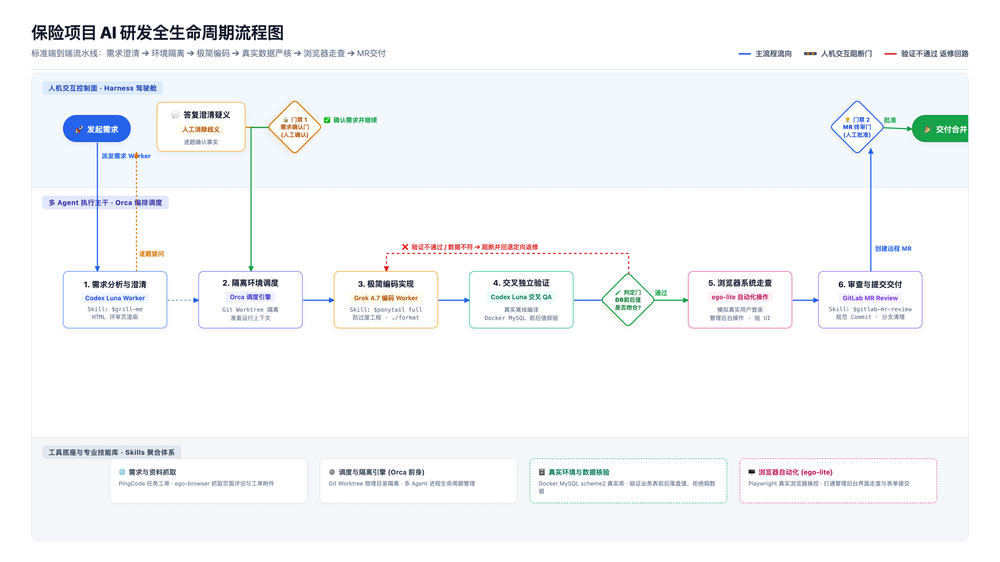

# AI 研发全生命周期自动化工作台 (Harness + Orca + Skills)

> **从「单点人机对话」走向「技能聚合与端到端闭环」**  
> 专为微服务与企业级业务打造的 AI 协同研发流水线。告别聊天窗口来回复制代码，让 AI 带着真实环境验证结果（Docker 数据库前后值落盘核验、ego-lite 浏览器真实走查）一键交付高质量 MR！

---

## ⚡ 一键极速安装（无需克隆仓库）

您**完全不需要克隆整个 Git 代码仓库**，直接在终端中复制并运行以下命令，即可自动从 GitHub Release 下载最新的 Skills 资产包并完成环境初始化：

```bash
curl -fsSL https://raw.githubusercontent.com/jianggw-stu/harness-ai-dev-starter/main/install.sh | bash
```

> **脚本自动完成的事项（双轨就绪）**：
> 1. **AI 底层技能包**：自动从 [GitHub Release](https://github.com/jianggw-stu/harness-ai-dev-starter/releases) 下载并安装全部核心 Skills 到 `~/.agents/skills/`；
> 2. **Harness 可视化操作台插件**：自动下载 `@local/auto-dev-flow` 插件并自动注册到本机的 `~/.dsh` 操作台中，**重启 Harness 即可直接在界面看到专属研发看板**！
> 3. **本地环境模板**：在当前目录下生成 `.env.local` 配置文件模板。

---

## 📌 架构全景与端到端流图

本项目包含完整的人机协同控制面、多 Agent 调度流水线以及专业技能库：



### 核心分工与四层架构

1. **人机驾驶舱（控制面）· Harness**：
   极简的人机交互界面，屏蔽底层命令行复杂度。团队成员在此输入工单、逐题回答业务澄清疑义、把关「需求确认门」与「交付合并门」。
2. **调度引擎（底座前身）· Orca**：
   幕后指挥中枢，负责多 Agent 状态机调度，自动为每个任务挂载干净独立的 `Git Worktree` 工作区，保障多任务并行互不污染。
3. **专业技能库 · 开源与自研 Skills 聚合**：
   即插即用的领域工具箱。包含业务澄清（`$grill-me`）、防过度工程（`$ponytail`）、高密度沟通（`$caveman`）、代码探查（`$codebase-investigation`）等。
4. **数字化手脚 · 真实环境 + ego-lite**：
   - **Docker MySQL 真实落盘**：绝不靠纯 Mock 或伪造数据瞒报，严格核对业务表改前、改后数据。
   - **ego-lite 浏览器操控**：让 AI 走出终端，像真人一样自动打开管理后台、核对页面 UI 与提交测试表单。

---

## 🛠️ 个性化配置替换（核心必读！）

运行完安装命令后，会在当前目录下生成本地配置文件：`.env.local`。  
由于每个人的电脑环境、仓库路径及 Docker 配置各不相同，模板中所有以 **`xxx`** 标记的配置项需要替换为您本机的真实信息：

```bash
vim .env.local
```

#### 📋 个性化 `xxx` 配置项速查表

| 配置变量名 | 默认模板占位符 | 说明与如何获取本机真实配置 |
| :--- | :--- | :--- |
| `JAVA_HOME` | `/xxx/path/to/jdk-11` | 您的 JDK 11 安装路径。Mac 用户可通过 `/usr/libexec/java_home -v 11` 查看。 |
| `MAVEN_HOME` | `/xxx/path/to/apache-maven-xxx` | 您的 Maven 安装根路径（建议 3.8+）。 |
| `MAVEN_SETTINGS`| `/xxx/path/to/.../settings.xml` | 您的 Maven 配置文件路径，确保配置了公司私服或阿里云镜像。 |
| `MAVEN_REPO` | `/xxx/path/to/maven-work` | 您的本地 Maven 缓存仓库目录，建议与 IntelliJ IDEA 中的设置保持一致。 |
| `LOCAL_TEST_DB_CONTAINER` | `xxx-mysql` | 本机 Docker MySQL 测试容器名（用于 AI 自动连接跑真实落地测试）。 |
| `LOCAL_TEST_DB_PORT` | `xxx` | 本机 MySQL 映射的主机端口（如 `3306` 或 `3306`）。 |
| `LOCAL_TEST_DB_NAME` | `xxx_test_db` | 测试数据库名称（根据当前开发模块的业务表创建）。 |
| `LOCAL_TEST_DB_PWD` | `xxx_password` | 本机测试 MySQL 数据库的 root 密码。 |
| `GITLAB_HOST` | `xxx.gitlab.com` | 团队自建 GitLab 域名。 |
| `GITLAB_TOKEN` | `xxx_personal_access_token`| 您的 GitLab 个人访问令牌（在 GitLab 个人设置 -> Access Tokens 中生成，需勾选 `api` 权限）。 |
| `WORK_ORDER_BASE_URL` | `https://xxx.pingcode.com` | 团队工单系统地址（如 PingCode、Jira 域名）。 |
| `OPENAI_API_KEY` | `sk-xxx` | 您的 AI 模型 API Key 或内网中转网关令牌。 |

---

## 🐳 拉起本地测试 Docker MySQL 容器

为了让 AI 在完成代码后能够进行**真实业务表读写核验**，请确保本机已运行 Docker 容器：

```bash
# 启动一个本地 MySQL 测试容器（以 3306 端口为例）
docker run -d \
  --name local-test-mysql \
  -p 3306:3306 \
  -e MYSQL_ROOT_PASSWORD=root \
  mysql:5.7

# 进入容器创建您的测试库，并导入初始 DDL/表结构
mysql -h 127.0.0.1 -P 3306 -u root -proot -e "CREATE DATABASE IF NOT EXISTS my_test_db DEFAULT CHARSET utf8mb4;"
```

---

## 🎯 日常研发使用流程（使用者操作 SOP）

1. **打开 Harness 驾驶舱**：
   启动 `DeepSeek Harness` 桌面客户端，在界面中选择或输入待开发的需求（例如粘贴工单任务链接或文字描述）。
2. **澄清需求与契约把关**：
   - AI 需求分析子 Agent（Codex Luna）会自动提取需求上下文；
   - 在 Harness 界面中会弹出 1~3 个业务疑义提问，您只需在输入框逐题答复；
   - 预览自动渲染的交互式 HTML 评审页，核对无误后点击**「确认需求并继续」**。
3. **全自动研发与双重验证（挂机等待）**：
   - **Orca** 调度引擎在后台自动创建隔离的分支环境；
   - **Grok** 编码 Worker 执行极简规范编码，并自动格式化代码；
   - **Codex 交叉 QA** 运行真实的离线 Maven 编译，并连上 Docker MySQL 核对业务表改前改后值；
   - **ego-lite** 自动调起无头浏览器，登录管理后台核验页面样式与业务表单交互；
4. **一键交付**：
   全部通过后，在 Harness 界面点击**「提交 MR」**，AI 自动生成标准化 Commit 并在 GitLab 上创建 Merge Request，直接交付人类审批合并！

---

## ❓ 常见问题排查 (FAQ)

### Q1: 运行 curl 安装命令提示连接超时？
- **原因**：可能受限于网络环境对 `raw.githubusercontent.com` 的访问。
- **解决办法**：您可以直接访问 [Releases 页面](https://github.com/jianggw-stu/harness-ai-dev-starter/releases/tag/v1.0.0)，下载 `skills.tar.gz` 手动解压至 `~/.agents/skills/` 即可。

### Q2: 验证阶段报告“数据库前后值不一致 / 测试失败”？
- **原因**：流水线拥有硬核的质量护栏，绝不允许仅凭 Mock 数据通过。
- **机制**：当 Docker 数据库中的写入值与预期断言不符时，系统会自动将失败证据打包，触发**红色定向返修回路**退回编码 Agent 重新修复，直到通过为止。

---

## 📄 开源许可与致谢

本项目基于 MIT 协议开源。感谢开源社区提供的各类优秀 Agent Skills 与工具生态！
